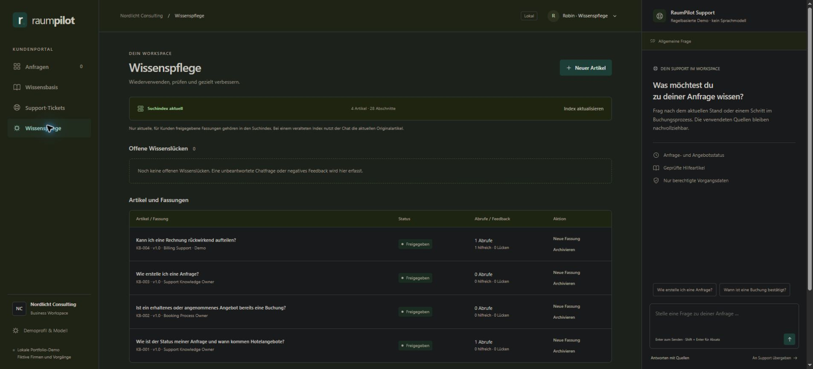

# RaumPilot — KCS + RAG Support Lab

A local B2B SaaS support project: reusable knowledge, permission-checked request data and a live chat with source-backed answers.

> **Current stage:** Local portal, Ollama chat, semantic retrieval and KCS-oriented editorial workflow implemented. Unanswered questions become knowledge gaps. An editor can draft, review, approve, version and archive articles. Only current customer-approved knowledge is searched. RaumPilot and all customers are fictional; this is a portfolio demonstration, not a production support service.



## The product

RaumPilot helps companies request hotel meeting rooms, compare offers and manage booking progress. The demonstration focuses on customer support, not real hotel inventory or payments.

The customer asks a question. General rules come from approved knowledge articles. Current request status comes from a separate permission-checked data service. A local language model will turn those inputs into a concise response with sources.

## Why this project

Support quality depends on both useful knowledge and correct case data. This lab demonstrates the connection between technical customer support, knowledge management and a practical chat assistant. A plausible answer is insufficient if it cites outdated rules or another company's request.

See [the fictional product and rules](docs/product-and-rules.md), [why KCS and RAG work together](docs/why-kcs-and-rag.md), and [the first example article](knowledge/KB-001-rfp-status.md).

## Project structure

```text
docs/                 Product rules, architecture decisions and acceptance criteria
knowledge/            Versioned articles; not a customer-record database
data/                 Synthetic companies, users, requests and article metadata
public/               Responsive portal and chat interface
src/                  Local HTTP backend, sessions, case access and support responses
tests/                Boundary and data tests
scripts/              Reproducible local retrieval evaluation
runtime/              Ignored local knowledge store, audit, feedback and search index
```

## Demonstration

1. Ask a public how-to question.
2. Ask about a request belonging to the current demo user.
3. Try an ID belonging to another company: no request details disclosed or sent to the model.
4. Ask a question with no approved answer: ask for clarification or hand off.
5. Update an article and verify index refresh/version citations.
6. Turn an unresolved question into a draft for human review.

## Start the local portal

Install Node.js 20 or newer, then clone this repository:

```bash
git clone https://github.com/luca-puckass-cloud/raumpilot-kcs-rag.git
cd raumpilot-kcs-rag
```

For local semantic search, start Ollama and install the embedding model once. For generated chat answers, also install a local chat model of your choice, such as `qwen3:8b`, and select it in the portal. Model downloads use disk space and local inference requires suitable hardware. The default rule-based mode also works without a chat model.

```bash
npm start
```

Open http://127.0.0.1:4175. No npm install is needed: the application uses Node's built-in modules only.

See [the portal walkthrough](docs/portal-walkthrough-de.md) for controls, test scenarios and operational limits.

## Run current tests

Requires Node.js 20 or newer. The automated tests use controlled embeddings/model responses and do not need Ollama. On constrained Node 24 environments, use `node --test --test-isolation=none tests/*.test.mjs`.

```bash
npm test
```

## Local-first approach

The chat connector calls Ollama at 127.0.0.1:11434 and rejects cloud model names. The default configured model is qwen3:8b. Choose any installed local model in the portal's demo settings, or set RAUMPILOT_MODEL before starting the server. Select the Ollama answer mode to enable local generation. If the chosen model is absent, unavailable or times out, the answer is explicitly labelled as rule-based fallback.

Semantic retrieval uses the local `qwen3-embedding:0.6b` model. Install it explicitly with `ollama pull qwen3-embedding:0.6b`; the server never downloads models automatically. Article sections and concise search descriptions are embedded, compared using cosine similarity and grouped by source revision. Explicit booking/status intent can select among the retrieved sources. A fingerprint blocks stale indexes; a clearly labelled keyword fallback searches the current approved originals when embeddings are unavailable.

The search threshold is calibrated on a small development set, not a universal confidence threshold. Its latest run found the correct top-ranked article in 10/12 cases; domain-intent selection chose the expected final source or abstention in 12/12. These figures measure source selection, not generated-answer accuracy. Run `node scripts/evaluate-retrieval.mjs` with Ollama running to reproduce [the evaluation](docs/evidence/retrieval-evaluation.json). See [the model checks](docs/model-check.md) for individual real-model cases.

The editorial workflow is available through the **Robin · Wissenspflege** demo profile. It persists article revisions, gaps, usage, feedback and audit history locally. Review/approval are human actions; the system does not silently publish a model-written draft. This demo permits the same editor to review and approve; it does not implement independent reviewer identities or a production four-eyes policy.

Responses do not carry model conversation history; each question is evaluated with the selected case context. Larger articles, broader held-out tests, prompt-injection evaluation and production identity controls remain future work.

No paid cloud resource, API key or external customer data is required. Local operation requires the machine and server to be running. New **request** drafts, tickets and demo sessions exist in server memory and reset on restart. Knowledge drafts and their history persist in `runtime/knowledge.json`. Demo profile switching is deliberately open for testing, not production authentication. Use only fictional input: gap capture strips request IDs and email addresses, not every possible personal detail.

This repository contains code, documentation and fictional fixtures, not model binaries, local runtime records or secrets. Publishing the source does not deploy the application: the portal and models run locally, with no cloud hosting provisioned.
